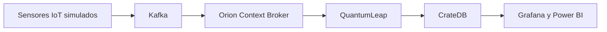
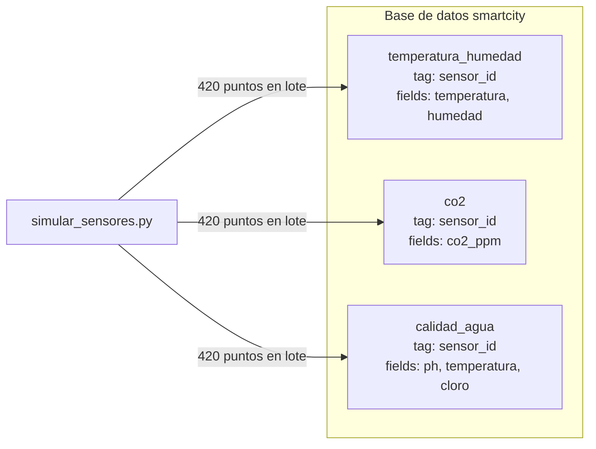
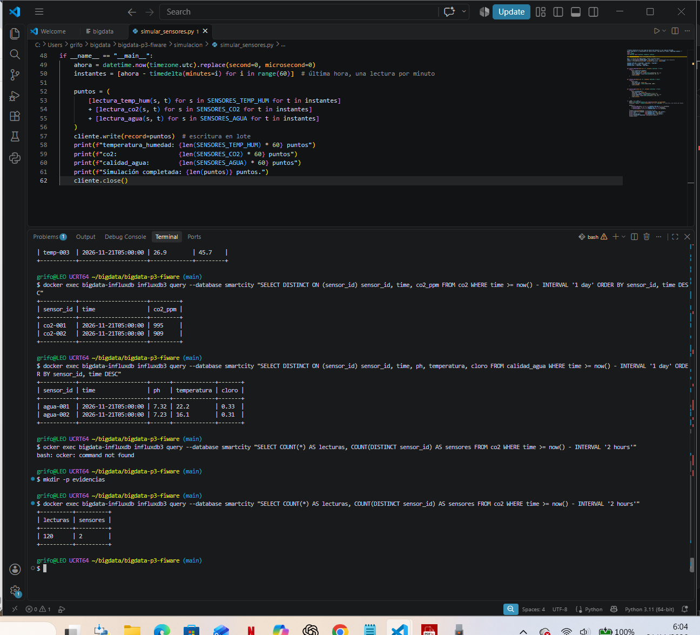
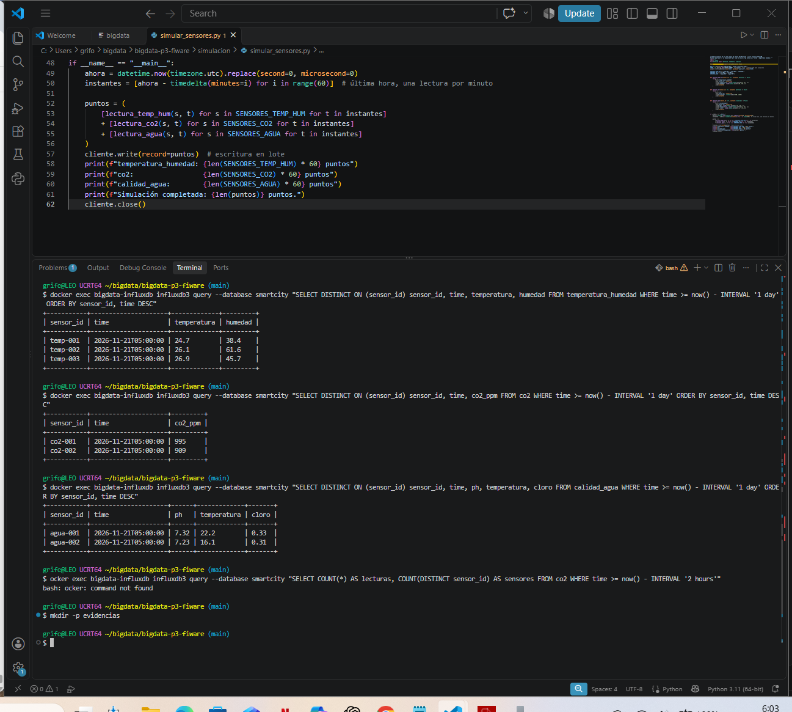

# Proyecto 3 · Smart City con FIWARE

## Descripción y objetivo

Simular una ciudad inteligente (Smart City) con la plataforma FIWARE, integrando sensores virtuales de temperatura y humedad, CO2 y calidad del agua para la captura, almacenamiento y visualización de datos en tiempo real. La arquitectura es streaming: los sensores publican en Kafka, Orion Context Broker gestiona el contexto, QuantumLeap persiste las series temporales en CrateDB y los datos se analizan con Grafana y Power BI.

## Arquitectura

Diagrama provisional del Bloque 0. Se actualizará bloque a bloque.



## Estructura del repositorio

| Carpeta | Contenido |
|---|---|
| `ingesta/` | Productores Kafka que simulan los sensores |
| `etl/` | Procesamiento en streaming |
| `dashboard/` | Cuadros de mando de Grafana y Power BI |

## Bitácora de prácticas → Bloque 2

### Práctica 10 · Parte B — Carga de lecturas en InfluxDB

**Entorno:** InfluxDB 3 Core en Docker (`bigdata-influxdb`, puerto 8181, `--without-auth` solo para clase), base de datos `smartcity`. El script se ejecuta en un contenedor `python:3.11-slim` dentro de la red `bigdata-p1-itaca-xml_bigdata-net`.

#### Modelo de measurements

Un measurement por tipo de sensor; en cada uno se agrupan las magnitudes que llegan juntas en la misma lectura.



| Measurement | Tag | Fields | Sensores simulados |
|---|---|---|---|
| temperatura_humedad | sensor_id | temperatura (float), humedad (float) | temp-001, temp-002, temp-003 |
| co2 | sensor_id | co2_ppm (int) | co2-001, co2-002 |
| calidad_agua | sensor_id | ph, temperatura, cloro (float) | agua-001, agua-002 |

#### Justificación de tags y fields (cardinalidad)

- **`sensor_id` es tag**: identifica la serie, las consultas filtran y agrupan por él, y tiene pocos valores estables (decenas de sensores). Series totales = 3 + 2 + 2 = **7**.
- **Las magnitudes medidas son fields**: tienen valores continuos e ilimitados. Como tags, cada valor distinto crearía una serie nueva y degradaría el rendimiento.
- **Un measurement por tipo de sensor**, no uno genérico con `tipo` + `valor`: así no se mezclan unidades (°C, ppm, pH) en un mismo campo y las consultas y el dashboard son directos.

#### Simulación y carga

`simulacion/simular_sensores.py` amplía el esqueleto del apartado 6 a los **tres tipos de sensor**: una lectura por minuto durante la última hora para cada sensor, escrita en un solo lote.

```bash
docker run --rm --network bigdata-p1-itaca-xml_bigdata-net -v "$(pwd -W)":/app -w /app \
  -e INFLUX_HOST=http://bigdata-influxdb:8181 python:3.11-slim \
  sh -c "pip install -q influxdb3-python && python simulacion/simular_sensores.py"
```

Resultado: 180 puntos de `temperatura_humedad`, 120 de `co2` y 120 de `calidad_agua` (**420 en total**).

> Se ejecuta en contenedor porque en este Windows el Control inteligente de aplicaciones bloquea la DLL de `pyarrow`, una dependencia de `influxdb3-python`.

#### Verificación

Q3, última lectura de cada sensor (devuelve exactamente una fila por sensor):

```sql
SELECT DISTINCT ON (sensor_id) sensor_id, time, temperatura, humedad
FROM temperatura_humedad
WHERE time >= now() - INTERVAL '1 day'
ORDER BY sensor_id, time DESC;
```

La misma consulta se lanza sobre `co2` y `calidad_agua`, y todas filtran por tiempo, como exige el modelo.

| Comprobación | Resultado |
|---|---|
| Lecturas de los tres tipos de sensor | temperatura_humedad 180 / 3 sensores · co2 120 / 2 · calidad_agua 120 / 2 |
| Q3 (`DISTINCT ON`) | 3, 2 y 2 filas: una por sensor, con su lectura más reciente |



## Bitácora de prácticas → Bloque 2

### Práctica 10 · Parte B — Carga de lecturas en InfluxDB

**Entorno:** InfluxDB 3 Core en Docker (`bigdata-influxdb`, puerto 8181, `--without-auth` solo para clase), base de datos `smartcity`. El script se ejecuta en un contenedor `python:3.11-slim` dentro de la red `bigdata-p1-itaca-xml_bigdata-net`.

#### Modelo de measurements

Un measurement por tipo de sensor; en cada uno se agrupan las magnitudes que llegan juntas en la misma lectura.


| Measurement | Tag | Fields | Sensores simulados |
|---|---|---|---|
| temperatura_humedad | sensor_id | temperatura (float), humedad (float) | temp-001, temp-002, temp-003 |
| co2 | sensor_id | co2_ppm (int) | co2-001, co2-002 |
| calidad_agua | sensor_id | ph, temperatura, cloro (float) | agua-001, agua-002 |

#### Justificación de tags y fields (cardinalidad)

- **`sensor_id` es tag**: identifica la serie, las consultas filtran y agrupan por él, y tiene pocos valores estables (decenas de sensores). Series totales = 3 + 2 + 2 = **7**.
- **Las magnitudes medidas son fields**: tienen valores continuos e ilimitados. Como tags, cada valor distinto crearía una serie nueva y degradaría el rendimiento.
- **Un measurement por tipo de sensor**, no uno genérico con `tipo` + `valor`: así no se mezclan unidades (°C, ppm, pH) en un mismo campo y las consultas y el dashboard son directos.

#### Simulación y carga

`simulacion/simular_sensores.py` amplía el esqueleto del apartado 6 a los **tres tipos de sensor**: una lectura por minuto durante la última hora para cada sensor, escrita en un solo lote.

```bash
docker run --rm --network bigdata-p1-itaca-xml_bigdata-net -v "$(pwd -W)":/app -w /app \
  -e INFLUX_HOST=http://bigdata-influxdb:8181 python:3.11-slim \
  sh -c "pip install -q influxdb3-python && python simulacion/simular_sensores.py"
```

Resultado: 180 puntos de `temperatura_humedad`, 120 de `co2` y 120 de `calidad_agua` (**420 en total**).

> Se ejecuta en contenedor porque en este Windows el Control inteligente de aplicaciones bloquea la DLL de `pyarrow`, una dependencia de `influxdb3-python`.

#### Verificación

Q3, última lectura de cada sensor (devuelve exactamente una fila por sensor):

```sql
SELECT DISTINCT ON (sensor_id) sensor_id, time, temperatura, humedad
FROM temperatura_humedad
WHERE time >= now() - INTERVAL '1 day'
ORDER BY sensor_id, time DESC;
```

La misma consulta se lanza sobre `co2` y `calidad_agua`, y todas filtran por tiempo, como exige el modelo.

| Comprobación | Resultado |
|---|---|
| Lecturas de los tres tipos de sensor | temperatura_humedad 180 / 3 sensores · co2 120 / 2 · calidad_agua 120 / 2 |
| Q3 (`DISTINCT ON`) | 3, 2 y 2 filas: una por sensor, con su lectura más reciente |


